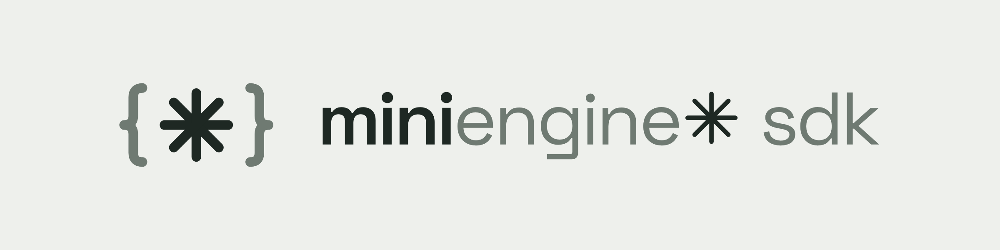

<picture>
  <source media="(prefers-color-scheme: dark)" srcset=".github/assets/banner-donker.png">
  
</picture>

# Miniengine✱ SDK

Typed, dependency-free browser client and game scaffolder for Mini Engine 0.5, published as the GitHub npm package [**@casb02/mini-engine-sdk**](https://github.com/Casb02/mini-engine-sdk/pkgs/npm/mini-engine-sdk) under the MIT license.

Documentation (Dutch): [docs.miniengine.nl](https://docs.miniengine.nl/), including the [API reference PDF](https://docs.miniengine.nl/downloads/MiniEngine-API-v0.5.pdf).

## Install

The package lives in GitHub Packages. Point the `@casb02` scope at it once, in your project's `.npmrc` (or `~/.npmrc`):

```ini
@casb02:registry=https://npm.pkg.github.com
//npm.pkg.github.com/:_authToken=${GITHUB_TOKEN}
```

GitHub Packages asks for a token even for public packages: create a [personal access token (classic)](https://github.com/settings/tokens) with only `read:packages`, and export it as `GITHUB_TOKEN` (or `gh auth token` if you use the GitHub CLI with that scope). Then:

```sh
npm install @casb02/mini-engine-sdk
```

**Without a token** you can install straight from the repository; npm builds it on install:

```sh
npm install github:Casb02/mini-engine-sdk           # latest main
npm install github:Casb02/mini-engine-sdk#v0.5.2    # a release tag
```

Requires Node.js 22+. The package ships the ESM client (`dist/`), one bundled declaration file (`types/`), the `create-mini-game` scaffolder (`bin/`) and the AI agent skills (`skills/`).

## Build a game in five minutes

**On a hosted engine** such as miniengine.nl, use the [Mini Engine CLI](https://github.com/Casb02/mini-engine-cli), which vendors this scaffolder:

```sh
npm install -g github:Casb02/mini-engine-cli
me game new my-vote
me game upload ./my-vote
```

**In a local engine checkout**, scaffold straight into its `games/` folder:

```sh
npx -p @casb02/mini-engine-sdk create-mini-game my-vote --directory ../mini-engine/games/my-vote
```

Restart Mini Engine from its checkout root with `cargo run`, open its `/home`, select **My Vote**, and create a room. Join from a second browser or device, click **I'm ready**, and start voting on the host. The generated host, player and display pages work immediately with the SDK served by Mini Engine at `/sdk/mini-engine.js`.

The starter is a complete trusted host-runtime game: the host validates votes, serializes state writes, shows totals to all roles, and supports repeated rounds. Keep its host tab open while playing. Change the question/defaults in `manifest.json`, game logic in `assets/app.js`, and appearance in `assets/style.css`. Each generated package includes its own README.

Scaffolder options:

```sh
npx -p @casb02/mini-engine-sdk create-mini-game another-game
npx -p @casb02/mini-engine-sdk create-mini-game another-game --directory /path/to/engine/games/another-game
npx -p @casb02/mini-engine-sdk create-mini-game --help
```

The destination must not exist and its final directory name must match the slug, as required by the engine catalog. Slugs use at most 48 lowercase letters, digits and single hyphens, starting with a letter. The CLI rejects unsafe slugs and never overwrites an existing directory.

## Build a game with an AI agent

The `skills/` directory contains [Agent Skills](https://agentskills.io/specification) (a `SKILL.md` with YAML frontmatter plus `references/`, `scripts/` or a `kit/`) that let a coding agent scaffold, implement, run and verify a Mini Engine game without guessing at the engine's rules:

| Skill | Use |
| --- | --- |
| [`build-mini-engine-game`](skills/build-mini-engine-game/SKILL.md) | The workflow: scaffold with `create-mini-game`, manifest and settings schema, host modes (the host plays along by default) and roles, host-runtime state (public, host-only and per-player secrets), rounds, the shared display, running the engine and verifying with several seats. References cover the SDK API, manifest/settings rules (including achievements and set kinds), host-runtime recipes (including realtime buzzers and positions, and awarding achievements) and troubleshooting; `scripts/play.mjs` drives a real room with Playwright. |
| [`design-mini-engine-game-ui`](skills/design-mini-engine-game-ui/SKILL.md) | Player (phone), display (TV across the room) and host (console) pages: each game's own atmosphere, touch targets, readability, self-hosted fonts, no inline scripts under the engine's CSP, reduced motion. |
| [`mini-engine-ui`](skills/mini-engine-ui/SKILL.md) | **MiniEngineUI**: the calm style of the Mini Engine demo games as a copy-in kit (stylesheet, Space Grotesk and DM Sans, host/player/display pages that fit the scaffold) with four themes (`kalk`, `nacht`, `vilt`, `studio`) and room for one signature element. The build skill asks whether you want it, and uses it when you only have an idea. |

The quickest way to install them for **Claude Code** is the CLI: `me skill install` (all projects) or `me skill install --project` (this project). Or copy them from the installed package:

```sh
mkdir -p ~/.claude/skills
cp -R node_modules/@casb02/mini-engine-sdk/skills/* ~/.claude/skills/   # all projects
mkdir -p .claude/skills
cp -R node_modules/@casb02/mini-engine-sdk/skills/* .claude/skills/     # this project only
```

Restart the agent session, then ask for example: *"Build a Mini Engine game where everyone secretly picks a number and the closest to 2/3 of the average wins; show the results on the shared screen."* The skill triggers on such requests; you can also name it (`/build-mini-engine-game` in Claude Code). It asks once whether to use MiniEngineUI; say *"use MiniEngineUI"* up front to skip the question.

**Other agents:** Codex, Gemini CLI, Copilot CLI and other agents that read the SKILL.md format also look in `~/.agents/skills/` (copy or symlink the same directories there, or into the location your agent documents). Agents without skill support can be pointed at the files directly: *"Read skills/build-mini-engine-game/SKILL.md in the Mini Engine SDK and follow it."* The skills test a game first with `me dev` from the Mini Engine CLI (a local fake engine, no checkout needed) and then on a real Mini Engine (a local checkout, or a hosted engine plus the CLI to upload) and scaffold with `npx -p @casb02/mini-engine-sdk create-mini-game` or `me game new`.

## Using the client

In a bundled app or a Node script, import the package:

```js
import { ApiClient, MiniEngine } from '@casb02/mini-engine-sdk';
```

For browser game packages served by the engine, import the copy the engine serves, so the client always matches that engine:

```js
import { MiniEngine, loadSession } from '/sdk/mini-engine.js';

const code = new URLSearchParams(location.search).get('room');
const session = loadSession(code, 'player');
if (!session) throw new Error('Open this page through the room launcher.');
const client = new MiniEngine(session);
client.on('snapshot', room => {
  console.log(room.status, room.players, room.public_state);
});
client.connect();
await client.waitForSnapshot();
await client.ready(true);
// After the host starts the generated vote game:
// await client.action('vote', { yes: true });
```

Do not open generated HTML with file:// or a static server. Mini Engine supplies the API, room sessions, WebSockets and game asset routes. Games are locally trusted code; review packages before installing them. Host-private data belongs in `data.json`, loaded through the authenticated game-data API, rather than public assets. A room can play with a player's own [set](#sets) instead; the same API then returns that set.

## HTTP and accounts

```ts
import { ApiClient, MiniEngine, saveSession } from '@casb02/mini-engine-sdk';

const api = new ApiClient({ baseUrl: 'http://localhost:3000' });
const { games } = await api.getGames();
const { token } = await api.login({ username: 'sander', password: 'your-password' });
api.accountToken = token;
const credentials = await api.createRoom({
  game_id: 'common-dice',
  name: 'Sander',
  config: { host_mode: 'hostless', display_enabled: false },
});
saveSession(credentials); // Browser sessionStorage; an explicit Storage adapter is also supported.
const client = new MiniEngine({ ...credentials, baseUrl: api.baseUrl }).connect();
await client.waitForSnapshot();
await client.ready(true);
// Once every participant is ready, a hostless participant may start:
await client.action('start');
await client.action('roll', { held: [] });
console.log(await api.stats());
```

Accounts are optional. Omitting `accountToken` creates/joins as a guest. Create/join requests use the account bearer; room snapshot and game-data requests use their explicit room bearer. Register/login return `{account,token}` without storing credentials automatically. Set `api.accountToken` after login/register and choose your own persistence. Logout clears it after server success.

`ApiClient` methods: `getGames()`, `getGame(id)`, `createRoom(options)`, `joinRoom(code,name)`, `getRoom(code,roomToken)`, `roomInfo(code)`, `gameData(code,hostToken)`, `displayToken(code,hostToken)`, `register({username,password,display_name,email})`, `verifyEmail(token)`, `setEmail(email)`, `login({username,password})`, `me()`, `stats()`, `achievements(accountToken?)`, `listSets({game_id?,kind?}?)`, `getSet(id)`, `createSet({game_id,kind,title,data})`, `updateSet(id,{title,data})`, `deleteSet(id)`, `logout()`.

`achievements` needs Mini Engine 0.5 (see [Achievements](#achievements)); so do the set methods and `createRoom({set_id})` (see [Sets](#sets)). An older engine answers the new routes with 404 and refuses `set_id` with 400. Since engine v0.4 registration needs an email address; the engine mails a confirmation link (`?verify=<token>`), which `verifyEmail` confirms while signed in to that account (set `accountToken` first). `Account` includes `email` and `email_verified`. `displayToken` rotates the display credential and returns `{token}`; only share it through the room launcher's URL fragment.

The original same-origin `http(path,{token,...fetchOptions})`, `getGames()`, `createRoom(options)` and `joinRoom(code,name)` exports remain available. `getGames()` returns `{games}`. `ApiClient({baseUrl,accountToken,fetch})` supports a separate server and custom fetch implementation; cross-origin browser requests require the server's CORS support.

Game metadata can declare `supports_late_join: false` when its rules cannot admit players after start. The optional capability defaults to true for legacy custom packages. Built-in Jeopardy disables late joining; Common Dice supports it. A room can enable `allow_late_join` only when its game supports the capability.

## WebSocket client

`new MiniEngine({code,token,baseUrl?,reconnectDelay?,requestTimeout?,WebSocket?,realtime?})` works in a browser or Node with a WebSocket implementation. Node callers must supply `baseUrl`; credentials are sent only in the first socket authentication frame. Room codes are normalized automatically. `realtime: {setInterval}` sets how often coalesced realtime values are sent (see [Realtime](#realtime)).

| Method | Behavior |
| --- | --- |
| `connect()` / `resume()` | Connect or explicitly resume a closed client; returns the client. |
| `on(type,fn)` / `once(type,fn)` | Subscribe; returns unsubscribe. `once` runs the callback once. |
| `waitForSnapshot(predicate?,{timeout?,signal?}?)` | Resolve with a matching current/future connected snapshot; timeout defaults to requestTimeout. |
| `ready(ready=true)` | Set your participant readiness in the lobby. |
| `action(name,data={}, {actionId}={})` | Send an action with a fresh action_id by default. |
| `configure({display_enabled?,allow_late_join?})` | Host lobby configuration, using latest version. Host mode is chosen on creation. |
| `setSettings(settings)` | Host settings update using latest version. |
| `setState({expected_version,public_state,host_state?,player_states?})` | Host-runtime state publishing. Server-runtime rooms reject this. |
| `lifecycle('running' / 'finished' / 'lobby')` | Host lifecycle update. |
| `award(playerId,achievementId)` | Host of a browser-host game: grant a declared achievement (Mini Engine 0.5, see [Achievements](#achievements)). |
| `realtime` | Ephemeral events and values (Mini Engine 0.5, see [Realtime](#realtime)). |
| `request(type,payload={})` | Raw correlated request, resolves with ack. |
| `close()` | Stop automatic retries, reject outstanding requests/waiters and forget realtime values. |

Events: `snapshot` receives the projected room itself, `action` the attributed host-runtime action envelope, `status` one of `connecting/connected/reconnecting/disconnected`, `error` an Error with server code, `closed` the terminal reason, `throttled` `{dropped}` when the engine dropped realtime messages of this connection, and `achievement` `{player_id,achievement}` when someone in the room earns an achievement. `client.room` holds the latest snapshot and `client.connected` becomes true only after authentication produces a snapshot. Snapshot generic parameters are `MiniEngine<PublicState,Settings,PrivateState>`.

Server-runtime mutations send a fresh projected snapshot before their success ack. An ack carries correlation, not state. Presence/readiness can change without a version increment. Subscribe to snapshots instead of assuming every snapshot has a new version. Role projections determine which private fields are present.

Outstanding commands reject on disconnect or timeout. Transient closures reconnect with bounded exponential backoff and fresh authentication; the SDK **never automatically replays commands**. After an uncertain result, inspect the latest snapshot. For an intentional retry of the same server-runtime action, reuse its explicit `actionId` (1–64 characters); server deduplication is scoped to actor and round and retains its last 256 ids. Host-runtime action acknowledgements confirm delivery to the host queue, not durable gameplay processing.

`MiniEngineError` exposes `.code` and optional HTTP `.status`. Explicitly handle errors from returned promises. An `error` event does not consume a rejected request promise.

## Realtime

Needs Mini Engine 0.5. `client.realtime` carries fast, short-lived messages next to the room state: buzzers, reactions, sound cues, positions, cursors. Nothing is stored, versioned or put in a snapshot, and the SDK never queues or replays it.

```js
// Events: fire and forget.
client.realtime.emit('buzz', { question: 3 }, { to: 'host' }); // false when not connected
const off = client.realtime.on('buzz', (data, from, ts, channel) => {
  console.log(from.player_id, ts); // from and ts are set by the server
});

// Values: the latest value per sender and key wins; late joiners get the current values.
client.realtime.set('kart', { x: 12, y: 40 }); // null deletes the key
client.realtime.onValue('kart', (value, from, ts, key) => draw(from.player_id, value));
client.realtime.value(playerId, 'kart'); // or 'host', 'display' or a from object
client.realtime.reset(); // host only: clear every value in the room
client.on('throttled', ({ dropped }) => console.warn(`${dropped} realtime messages dropped`));
```

| Member | Behavior |
| --- | --- |
| `emit(channel,data=null,{to?,echo?}?)` | Send an event. Returns `false` when not connected: the event is dropped, not queued. `to` is `'all'` (default), `'host'`, `'players'`, `'display'` or an array of at most 16 player ids. The sender does not receive its own event unless `echo: true`. |
| `on(channel,fn)` | `fn(data, from, ts, channel)`; `'*'` listens to every channel. Returns an unsubscribe function. |
| `set(key,value)` | Set this connection's value for a key; `null` deletes it. Coalesced per key and sent at most every 33 ms (`new MiniEngine({…, realtime: {setInterval: 50}})` changes that). Your own value is visible locally at once. Does nothing while not connected. |
| `value(from,key)` | The latest value of a key from a sender: `'host'`, `'display'`, a player id or a `from` object. `undefined` when there is none. |
| `onValue(key,fn)` | `fn(value, from, ts, key)`; `'*'` listens to every key. `value` is `null` when the key was deleted, also when its player left or the host reset the values. |
| `reset()` | Host only: clear every value in the room; every `onValue` handler gets `null` for each key. Values the host sets after calling it are kept. Other roles get a `forbidden` error event. |

`from` is `{role, player_id}` and `ts` is the time the engine received the message, in milliseconds since the Unix epoch. The engine sets both; clients cannot. Because `ts` is arrival time, network latency counts: every phone is judged on one clock, but a slow connection arrives later. Every role may emit and set (host, players and display); values are kept per sender, so nobody can overwrite another sender's values. Event and value handlers that throw are logged and do not stop the others.

Limits:

- Channel and key names are 1–64 of `A–Z a–z 0–9 _ . : -`; `data` and `value` are any JSON up to 2 KiB serialized. An invalid message produces an `error` event with code `invalid_request`; the socket stays open.
- Each connection may send 60 realtime messages per second, with bursts up to 120, separate from the command budget. Messages over the budget are dropped silently; the `throttled` event reports how many, at most once per 5 seconds. The socket is never closed for realtime traffic.
- Values: at most 64 keys per sender and 256 KiB per room. A `set` over either cap is dropped for everyone else (your own local copy still shows it) and reported through `throttled` too.

Loss and ordering:

- Realtime may lose messages under load: a slow receiver skips realtime frames and keeps its state up to date. There is no ordering relative to snapshots and acks. When order matters, as with buzzers, sort by `ts` instead of arrival.
- Never let a realtime message be the only record of something that counts. Decide on the host (or the server), then publish the outcome in the room state.
- Values survive reconnects: after the first snapshot of a new connection the engine sends the current values, and `onValue` handlers fire for what changed in the meantime. Values set while disconnected are not sent later. A player's values disappear when they leave or are removed; all values disappear when the room closes or expires or the engine restarts. `close()` forgets the local copy.

## Achievements

Needs Mini Engine 0.5. A game declares achievements in its manifest; players with an account earn them, and they stay on that account.

```json
"achievements": [
  { "id": "winnaar", "title": "Winnaar", "description": "Win een show met je team." },
  { "id": "foutloos", "title": "Foutloos", "description": "Geef minstens drie goede antwoorden in één show, zonder fout." }
]
```

`Manifest.achievements` is optional: at most 50 per game, `id` matches `^[a-z0-9][a-z0-9_-]{0,47}$` and is unique, `title` has 1–60 characters and `description` 1–160. The engine checks them whenever it loads a game, built-in or uploaded, and `GET /api/v1/games` shows them.

Built-in server games (Common Dice, Jeopardy) award their own achievements at the end of a round, with `source: 'server'`. In a browser-host game the host awards them:

```js
await client.award(player.id, 'winnaar'); // also acks when the player already had it
client.on('achievement', ({ player_id, achievement }) => {
  celebrate(player_id, achievement.title); // every connection in the room receives this
});
const { achievements } = await api.achievements(); // the signed-in account, newest first
```

`client.award(playerId, achievementId)` sends the `award` command; `POST /api/v1/rooms/{code}/achievements` with the host token and `{player_id, achievement_id}` does the same over HTTP and answers `{player_id, achievement, already_earned}`.

Trust rules: the engine checks every award from a browser-host game.

- Only the host of a browser-host room awards; a server-runtime room answers `forbidden`.
- The room is `running` or `finished` (`game_not_running` otherwise).
- The player has a seat in the room (`player_not_found` otherwise) and plays with an account (`not_eligible` for a guest). A moderator and the display have no seat and never earn achievements; since 0.5.1 a host who plays along has a seat (`Snapshot.host_player_id`) and earns them like any player. The engine takes the account from its own seat record, never from the client.
- The achievement is declared in the release the room is pinned to (`achievement_unknown`). A new achievement works in rooms created after its release is active.
- The room was created by someone who was logged in, and the receiving account is not that creator's own account (`not_eligible`): no awards to yourself. Since 0.5.1 the host's own seat is the exception, and since 0.5.2 so is any seat in a `tv` room (the TV is a device, not a player); another seat with the host's account in a moderator room is still refused.
- At most 30 awards per room per minute (`rate_limit`).
- Awarding an achievement a second time changes nothing and still acks. Title and description are stored at the moment of the award, so they survive later releases.

Game code runs in the host's browser, so the engine cannot verify why a browser-host game gave an award. Those awards are stored with `source: 'game'`, and the account page shows them in a separate group, "Toegekend door eigen spellen". Statistics stay server-only.

The `achievement` event reaches every connection in the room the first time a player earns an achievement: `{player_id, achievement: {id, title, description}}`. It is not versioned or part of a snapshot and, like realtime, can be lost under load.

`api.achievements(accountToken?)` reads `GET /api/v1/accounts/achievements` with the given token or the client's `accountToken`: newest first, each `{game_id, game_title, id, title, description, source, awarded_at}`. `game_title` is `null` when the engine no longer knows the game; `awarded_at` is in seconds since the Unix epoch.

## Sets

Needs Mini Engine 0.5. A game can let players save their own content on their account, such as their own Jeopardy board, and pick it when they create a room.

```json
"set_kinds": [{
  "id": "board",
  "title": "Vragenbord",
  "description": "Eén tot zes categorieën met elk vijf vragen.",
  "schema": {
    "type": "object",
    "additionalProperties": false,
    "required": ["categories"],
    "properties": {
      "categories": {
        "type": "array", "minItems": 1, "maxItems": 6,
        "items": {
          "type": "object",
          "additionalProperties": false,
          "required": ["title", "clues"],
          "properties": {
            "title": { "type": "string", "minLength": 1, "maxLength": 40 },
            "clues": {
              "type": "array", "minItems": 5, "maxItems": 5,
              "items": {
                "type": "object",
                "additionalProperties": false,
                "required": ["question", "answer"],
                "properties": {
                  "question": { "type": "string", "minLength": 1, "maxLength": 240 },
                  "answer": { "type": "string", "minLength": 1, "maxLength": 240 }
                }
              }
            }
          }
        }
      }
    }
  }
}]
```

`Manifest.set_kinds` is optional: at most 4 kinds per game, `id` follows the achievement id rules, `title` has 1–60 characters and `description` 1–160. `schema` uses the set schema dialect, a small part of JSON Schema (typed as `SetSchema`):

| `type` | Allowed keys |
| --- | --- |
| `object` | `properties` (required), `required` (unique names of its own properties), `additionalProperties: false` (required) |
| `array` | `items` (required), `minItems`, `maxItems` |
| `string` | `minLength`, `maxLength` (in characters), `enum` (at most 256 unique strings, each within the length bounds) |
| `integer`, `number` | `minimum`, `maximum` |
| `boolean` | none |

Every node may also have a `title` and a `description`. Counts are whole numbers of 0 or more, and a minimum is never above its maximum. Anything else, such as `$ref`, `pattern`, `default` or a `null` type, makes the engine refuse the game, whether it is on disk or uploaded. A schema is at most 8 levels deep and has at most 256 nodes. A property that is not `required` may be left out, but not set to `null`. When data does not fit, the error names the place, for example `categories[0].clues[2].question: gebruik 1–240 tekens.` `settings_schema` keeps its own, flat rules.

Saving sets uses the account token; a confirmed email address is not needed.

```ts
interface Board { categories: { title: string; clues: { question: string; answer: string }[] }[] }

api.accountToken = token;
const created = await api.createSet<Board>({ game_id: 'jeopardy', kind: 'board', title: 'Filmavond', data: board });
const { sets } = await api.listSets({ game_id: 'jeopardy', kind: 'board' });
const saved = await api.getSet<Board>(created.id);
await api.updateSet(saved.id, { title: 'Filmavond met Pim', data: saved.data });
```

| Method | Route | Notes |
| --- | --- | --- |
| `listSets({game_id?,kind?}?)` | `GET /api/v1/accounts/sets` | `{sets}` without content: `{id, game_id, kind, title, size, created_at, updated_at}`, most recently changed first. |
| `getSet(id)` | `GET /api/v1/accounts/sets/{id}` | The set with its `data`. Another account's set answers 404 `set_not_found`. |
| `createSet({game_id,kind,title,data})` | `POST /api/v1/accounts/sets` | The kind must be declared by the game's active release; the data must match its schema and the game's own checks (Jeopardy: unique category titles). |
| `updateSet(id,{title,data})` | `PUT /api/v1/accounts/sets/{id}` | Replaces title and content, checked again; game and kind never change. Rooms that already use the set keep their copy. |
| `deleteSet(id)` | `DELETE /api/v1/accounts/sets/{id}` | Resolves to `null`. |

Limits: a title has 1–80 characters, `data` is at most 64 KiB serialized (413 `set_too_large`), an account keeps at most 50 sets (409 `quota_sets`), and one address makes at most 30 set changes per minute. `size` is in bytes; times are seconds since the Unix epoch. `createSet` and `updateSet` accept any JSON-shaped type, interfaces included (`JsonCompatible<T>`); functions, dates, maps and `undefined` are type errors.

To play with a set, pass its id when you create the room:

```ts
const credentials = await api.createRoom({ game_id: 'jeopardy', set_id: saved.id }); // with api.accountToken set
```

- `CreateRoomOptions.set_id` needs the account token (401 `unauthorized` for a guest). The set must belong to that account (404 `set_not_found`) and to the same game, and its kind must be declared in the release the room is pinned to; the content is checked again. If the game gets a new release at that very moment, the engine answers 409 `release_changed`: try again.
- The room keeps its own copy. Editing or deleting the saved set later does not change a running room.
- `Snapshot.set` is `{id, kind, title}` for every role, or `null` without a set, so a lobby or display can show "Bord: Filmavond". The content is never part of a snapshot.
- The set replaces the game's `data.json` for that room. A built-in game plays with it; in a browser-host game the host reads it with `api.gameData(code, hostToken)`, which returns the set's `data` instead of `data.json`. Give `data.json` the shape of your set kind, or check `room.set?.kind`, so one code path reads both.

## Releasing

Bump `version` in `package.json`, merge, then tag: `git tag v0.5.2 && git push origin v0.5.2`. The [publish workflow](.github/workflows/publish.yml) runs the full check and publishes the tag to GitHub Packages with the repository's own `GITHUB_TOKEN`; the tag must match the package version.

## Sessions and distribution

`sessionKey(code,role)`, `saveSession(credentials,storage?)`, `loadSession(code,role,storage?)`, `removeSession(code,role,storage?)` retain the existing `mini-engine:CODE:ROLE` sessionStorage format. Storage helpers never put secrets into URL query strings. The room launcher consumes display credentials from the URL fragment before loading the game iframe.

`dist/mini-engine.js` is one bundled ES module suitable for the engine's `/sdk/mini-engine.js` route; it has no runtime package dependencies. Its declarations are the committed file `types/mini-engine.d.ts` (see [TypeScript types](#typescript-types)). Engine maintainers vendor both with the engine's `npm run sdk:sync -- /path/to/mini-engine-sdk`; game packages consume the engine-served copy.

```sh
npm run check         # Types up to date, build, strict typed consumer, transport/API/CLI tests
npm run test:package  # Pack, install without scripts, import and run installed CLI
```

## TypeScript types

The whole public API is described by one self-contained declaration file, [`types/mini-engine.d.ts`](types/mini-engine.d.ts): no imports, no other files needed. It is generated from `src/` by `npm run build` (`scripts/build-types.mjs` type-checks the sources, stitches tsc's per-module declarations into one module and compiles the result on its own) and committed, so it is readable on GitHub without a build. `npm run check` starts with `npm run types:check`, which regenerates it in memory and fails when the committed file is stale; after changing `src/`, run `npm run build` and commit `types/mini-engine.d.ts` with your change. Do not edit it by hand.

Where the types are picked up:

- **npm/tarball consumers:** `package.json` `types` and `exports["."].types` point at `types/mini-engine.d.ts`, so `import { MiniEngine } from '@casb02/mini-engine-sdk'` is typed in TypeScript and in JavaScript editors.
- **Mini Engine checkout:** `npm run sdk:sync` copies the file to the engine's `web/mini-engine.d.ts` next to the served bundle and pins its hash in `sdk-version.json` (`npm run sdk:check` verifies both).
- **Scaffolded games:** `create-mini-game` writes `jsconfig.json` and a copy of the declarations in `types/mini-engine.d.ts`. Game code keeps importing the rooted browser path `/sdk/mini-engine.js`; TypeScript applies `compilerOptions.paths` to that specifier and resolves it to `../../web/mini-engine.d.ts` when the game lives in an engine checkout's `games/<slug>/` (always matching the SDK that engine serves), otherwise to the game's own `types/mini-engine.d.ts`. `checkJs` and `strict` are on, so VS Code and other TypeScript-based editors give completion and underline wrong SDK calls in plain JavaScript without a build step or an import map. The generated `assets/app.js` declares its state and settings shapes with JSDoc (`@typedef`, `@type {MiniEngine<PublicState, Settings>}`) and passes the check. From a terminal: `npx -p typescript tsc -p jsconfig.json` inside the game directory. The engine only serves `assets/`, so `jsconfig.json` and `types/` never reach browsers.

CI runs those checks on Node 22 and 24. Publishing only happens from a version tag (see [Releasing](#releasing)).

To test the generated game against a real engine, first build a Mini Engine 0.5 checkout with `cargo build`, then run:

```sh
MINI_ENGINE_CHECKOUT=/absolute/path/to/mini-engine npm run test:engine
```

This optional integration check starts an isolated engine with a temporary database, loads the generated package through its actual catalog, and executes all three generated role scripts in a DOM harness with real WebSockets. It verifies readiness, start, simultaneous votes, shared display totals and round reset, then removes its temporary data.
